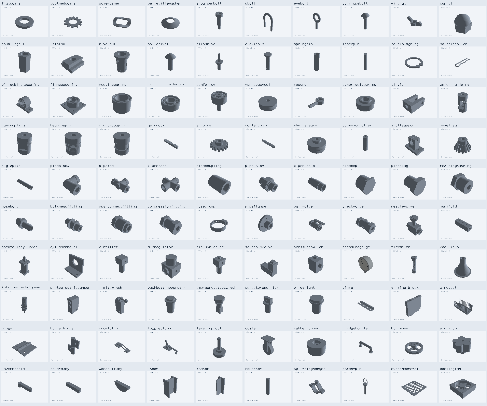

# Industrial component catalog

100 fundamental component families for mechanical assemblies and industrial automation. Each family has a distinct model name with configurable dimensions normalized to millimeters. The catalog uses nominal custom envelopes; threaded surfaces, bearings, gears and valve internals use the simplifications documented in the group guides.

The duplicate audit reviewed all 274 historical PRs authored by seveibar (104 modelprinter, 170 jscad-electronics), including closed and unmerged proposals, as well as both main registries. See [audit](industrial-model-pr-audit.json).

## Fasteners And Retainers (20)

| Model | Distinguishing geometry | Example and four-view snapshot |
| --- | --- | --- |
| `flatwasher` | Flat load-spreading annulus | [example](../examples/FlatWasher.example.tsx) / [snapshot](../tests/snapshots/__snapshots__/flatwasher.snap.png) |
| `toothedwasher` | Annulus with radial locking teeth | [example](../examples/ToothedWasher.example.tsx) / [snapshot](../tests/snapshots/__snapshots__/toothedwasher.snap.png) |
| `wavewasher` | Axially undulating annulus | [example](../examples/WaveWasher.example.tsx) / [snapshot](../tests/snapshots/__snapshots__/wavewasher.snap.png) |
| `bellevillewasher` | Conical annulus | [example](../examples/BellevilleWasher.example.tsx) / [snapshot](../tests/snapshots/__snapshots__/bellevillewasher.snap.png) |
| `shoulderbolt` | Large shoulder, small shank and socket head | [example](../examples/ShoulderBolt.example.tsx) / [snapshot](../tests/snapshots/__snapshots__/shoulderbolt.snap.png) |
| `ubolt` | Bent U rod with two parallel legs | [example](../examples/UBolt.example.tsx) / [snapshot](../tests/snapshots/__snapshots__/ubolt.snap.png) |
| `eyebolt` | Axial shank with ring eye | [example](../examples/EyeBolt.example.tsx) / [snapshot](../tests/snapshots/__snapshots__/eyebolt.snap.png) |
| `carriagebolt` | Domed head and square neck | [example](../examples/CarriageBolt.example.tsx) / [snapshot](../tests/snapshots/__snapshots__/carriagebolt.snap.png) |
| `wingnut` | Central bore and two wings | [example](../examples/WingNut.example.tsx) / [snapshot](../tests/snapshots/__snapshots__/wingnut.snap.png) |
| `capnut` | Hex base with closed dome | [example](../examples/CapNut.example.tsx) / [snapshot](../tests/snapshots/__snapshots__/capnut.snap.png) |
| `couplingnut` | Long hex sleeve with through bore | [example](../examples/CouplingNut.example.tsx) / [snapshot](../tests/snapshots/__snapshots__/couplingnut.snap.png) |
| `tslotnut` | T-section threaded slug | [example](../examples/TSlotNut.example.tsx) / [snapshot](../tests/snapshots/__snapshots__/tslotnut.snap.png) |
| `rivetnut` | Flanged cylindrical insert and blind bore | [example](../examples/RivetNut.example.tsx) / [snapshot](../tests/snapshots/__snapshots__/rivetnut.snap.png) |
| `solidrivet` | Domed head and solid shank | [example](../examples/SolidRivet.example.tsx) / [snapshot](../tests/snapshots/__snapshots__/solidrivet.snap.png) |
| `blindrivet` | Flanged sleeve and projecting mandrel | [example](../examples/BlindRivet.example.tsx) / [snapshot](../tests/snapshots/__snapshots__/blindrivet.snap.png) |
| `clevispin` | Headed shaft with transverse retention bore | [example](../examples/ClevisPin.example.tsx) / [snapshot](../tests/snapshots/__snapshots__/clevispin.snap.png) |
| `springpin` | Slit cylindrical tube | [example](../examples/SpringPin.example.tsx) / [snapshot](../tests/snapshots/__snapshots__/springpin.snap.png) |
| `taperpin` | Tapered solid rod | [example](../examples/TaperPin.example.tsx) / [snapshot](../tests/snapshots/__snapshots__/taperpin.snap.png) |
| `retainingring` | Split C-ring with lug holes | [example](../examples/RetainingRing.example.tsx) / [snapshot](../tests/snapshots/__snapshots__/retainingring.snap.png) |
| `hairpincotter` | Bent hairpin wire with curved retention leg | [example](../examples/HairpinCotter.example.tsx) / [snapshot](../tests/snapshots/__snapshots__/hairpincotter.snap.png) |

## Motion Transmission And Bearings (20)

| Model | Distinguishing geometry | Example and four-view snapshot |
| --- | --- | --- |
| `pillowblockbearing` | Bearing in foot-mounted housing | [example](../examples/PillowBlockBearing.example.tsx) / [snapshot](../tests/snapshots/__snapshots__/pillowblockbearing.snap.png) |
| `flangebearing` | Bearing in pierced flange housing | [example](../examples/FlangeBearing.example.tsx) / [snapshot](../tests/snapshots/__snapshots__/flangebearing.snap.png) |
| `needlebearing` | Races and slender roller cage | [example](../examples/NeedleBearing.example.tsx) / [snapshot](../tests/snapshots/__snapshots__/needlebearing.snap.png) |
| `cylindricalrollerbearing` | Races and large cylindrical rollers | [example](../examples/CylindricalRollerBearing.example.tsx) / [snapshot](../tests/snapshots/__snapshots__/cylindricalrollerbearing.snap.png) |
| `camfollower` | Bearing wheel with projecting stud | [example](../examples/CamFollower.example.tsx) / [snapshot](../tests/snapshots/__snapshots__/camfollower.snap.png) |
| `vgroovewheel` | Wheel with V running groove | [example](../examples/VGrooveWheel.example.tsx) / [snapshot](../tests/snapshots/__snapshots__/vgroovewheel.snap.png) |
| `rodend` | Eye with spherical bearing and stem | [example](../examples/RodEnd.example.tsx) / [snapshot](../tests/snapshots/__snapshots__/rodend.snap.png) |
| `sphericalbearing` | Bored spherical inner member in outer race | [example](../examples/SphericalBearing.example.tsx) / [snapshot](../tests/snapshots/__snapshots__/sphericalbearing.snap.png) |
| `clevis` | Fork with two cross-pierced ears | [example](../examples/Clevis.example.tsx) / [snapshot](../tests/snapshots/__snapshots__/clevis.snap.png) |
| `universaljoint` | Two yokes connected by cross | [example](../examples/UniversalJoint.example.tsx) / [snapshot](../tests/snapshots/__snapshots__/universaljoint.snap.png) |
| `jawcoupling` | Opposed jaw hubs and center spider | [example](../examples/JawCoupling.example.tsx) / [snapshot](../tests/snapshots/__snapshots__/jawcoupling.snap.png) |
| `beamcoupling` | Sleeve with helical flexure slots | [example](../examples/BeamCoupling.example.tsx) / [snapshot](../tests/snapshots/__snapshots__/beamcoupling.snap.png) |
| `oldhamcoupling` | Two hubs and orthogonally grooved center disk | [example](../examples/OldhamCoupling.example.tsx) / [snapshot](../tests/snapshots/__snapshots__/oldhamcoupling.snap.png) |
| `gearrack` | Linear tooth row on base | [example](../examples/GearRack.example.tsx) / [snapshot](../tests/snapshots/__snapshots__/gearrack.snap.png) |
| `sprocket` | Chain-toothed wheel and bore | [example](../examples/Sprocket.example.tsx) / [snapshot](../tests/snapshots/__snapshots__/sprocket.snap.png) |
| `rollerchain` | Repeated paired plate, pin and roller links | [example](../examples/RollerChain.example.tsx) / [snapshot](../tests/snapshots/__snapshots__/rollerchain.snap.png) |
| `vbeltsheave` | Pulley with V belt groove | [example](../examples/VBeltSheave.example.tsx) / [snapshot](../tests/snapshots/__snapshots__/vbeltsheave.snap.png) |
| `conveyorroller` | Drum with end bearings and axle | [example](../examples/ConveyorRoller.example.tsx) / [snapshot](../tests/snapshots/__snapshots__/conveyorroller.snap.png) |
| `shaftsupport` | Split bore pedestal on pierced feet | [example](../examples/ShaftSupport.example.tsx) / [snapshot](../tests/snapshots/__snapshots__/shaftsupport.snap.png) |
| `bevelgear` | Conical tooth wheel and hub | [example](../examples/BevelGear.example.tsx) / [snapshot](../tests/snapshots/__snapshots__/bevelgear.snap.png) |

## Pipes Fittings And Valves (20)

| Model | Distinguishing geometry | Example and four-view snapshot |
| --- | --- | --- |
| `rigidpipe` | Annular rigid pipe with cut ends | [example](../examples/RigidPipe.example.tsx) / [snapshot](../tests/snapshots/__snapshots__/industrial-rigidpipe.snap.png) |
| `pipeelbow` | Right-angle curved bore | [example](../examples/PipeElbow.example.tsx) / [snapshot](../tests/snapshots/__snapshots__/industrial-pipeelbow.snap.png) |
| `pipetee` | Three intersecting ports | [example](../examples/PipeTee.example.tsx) / [snapshot](../tests/snapshots/__snapshots__/industrial-pipetee.snap.png) |
| `pipecross` | Four intersecting ports | [example](../examples/PipeCross.example.tsx) / [snapshot](../tests/snapshots/__snapshots__/industrial-pipecross.snap.png) |
| `pipecoupling` | Thick annular coupling sleeve | [example](../examples/PipeCoupling.example.tsx) / [snapshot](../tests/snapshots/__snapshots__/industrial-pipecoupling.snap.png) |
| `pipeunion` | Two pipe ends with central hex union | [example](../examples/PipeUnion.example.tsx) / [snapshot](../tests/snapshots/__snapshots__/industrial-pipeunion.snap.png) |
| `pipenipple` | Short pipe with raised threaded end envelopes | [example](../examples/PipeNipple.example.tsx) / [snapshot](../tests/snapshots/__snapshots__/industrial-pipenipple.snap.png) |
| `pipecap` | Closed end with blind bore | [example](../examples/PipeCap.example.tsx) / [snapshot](../tests/snapshots/__snapshots__/industrial-pipecap.snap.png) |
| `pipeplug` | Solid hex-headed plug | [example](../examples/PipePlug.example.tsx) / [snapshot](../tests/snapshots/__snapshots__/industrial-pipeplug.snap.png) |
| `reducingbushing` | Hex head and stepped bore | [example](../examples/ReducingBushing.example.tsx) / [snapshot](../tests/snapshots/__snapshots__/industrial-reducingbushing.snap.png) |
| `hosebarb` | Raised conical barb rings and bore | [example](../examples/HoseBarb.example.tsx) / [snapshot](../tests/snapshots/__snapshots__/industrial-hosebarb.snap.png) |
| `bulkheadfitting` | Tube with flange and locknut | [example](../examples/BulkheadFitting.example.tsx) / [snapshot](../tests/snapshots/__snapshots__/industrial-bulkheadfitting.snap.png) |
| `pushconnectfitting` | Fitting body with collet and bore | [example](../examples/PushConnectFitting.example.tsx) / [snapshot](../tests/snapshots/__snapshots__/industrial-pushconnectfitting.snap.png) |
| `compressionfitting` | Fitting body with compression nuts | [example](../examples/CompressionFitting.example.tsx) / [snapshot](../tests/snapshots/__snapshots__/industrial-compressionfitting.snap.png) |
| `hoseclamp` | Clamping band and screw housing | [example](../examples/HoseClamp.example.tsx) / [snapshot](../tests/snapshots/__snapshots__/industrial-hoseclamp.snap.png) |
| `pipeflange` | Annulus with bolt circle | [example](../examples/PipeFlange.example.tsx) / [snapshot](../tests/snapshots/__snapshots__/industrial-pipeflange.snap.png) |
| `ballvalve` | Inline valve body, ports and lever | [example](../examples/BallValve.example.tsx) / [snapshot](../tests/snapshots/__snapshots__/industrial-ballvalve.snap.png) |
| `checkvalve` | Inline valve with identifiable direction feature | [example](../examples/CheckValve.example.tsx) / [snapshot](../tests/snapshots/__snapshots__/industrial-checkvalve.snap.png) |
| `needlevalve` | Valve body with stem and handwheel | [example](../examples/NeedleValve.example.tsx) / [snapshot](../tests/snapshots/__snapshots__/industrial-needlevalve.snap.png) |
| `manifold` | Rectangular bar with intersecting port array | [example](../examples/Manifold.example.tsx) / [snapshot](../tests/snapshots/__snapshots__/industrial-manifold.snap.png) |

## Industrial Automation (20)

| Model | Distinguishing geometry | Example and four-view snapshot |
| --- | --- | --- |
| `pneumaticcylinder` | Barrel, end caps and extending rod | [example](../examples/PneumaticCylinder.example.tsx) / [snapshot](../tests/snapshots/__snapshots__/pneumaticcylinder.snap.png) |
| `cylindermount` | Cylinder bracket with mounting or pivot bores | [example](../examples/CylinderMount.example.tsx) / [snapshot](../tests/snapshots/__snapshots__/cylindermount.snap.png) |
| `airfilter` | Ported head and filter bowl | [example](../examples/AirFilter.example.tsx) / [snapshot](../tests/snapshots/__snapshots__/airfilter.snap.png) |
| `airregulator` | Ported body and adjustment knob | [example](../examples/AirRegulator.example.tsx) / [snapshot](../tests/snapshots/__snapshots__/airregulator.snap.png) |
| `airlubricator` | Ported head, oil bowl and sight dome | [example](../examples/AirLubricator.example.tsx) / [snapshot](../tests/snapshots/__snapshots__/airlubricator.snap.png) |
| `solenoidvalve` | Multiport block with coil | [example](../examples/SolenoidValve.example.tsx) / [snapshot](../tests/snapshots/__snapshots__/solenoidvalve.snap.png) |
| `pressureswitch` | Pressure connection, body and electrical head | [example](../examples/PressureSwitch.example.tsx) / [snapshot](../tests/snapshots/__snapshots__/pressureswitch.snap.png) |
| `pressuregauge` | Round case, readable dial features and stem | [example](../examples/PressureGauge.example.tsx) / [snapshot](../tests/snapshots/__snapshots__/pressuregauge.snap.png) |
| `flowmeter` | Transparent measuring tube with float and end fittings | [example](../examples/FlowMeter.example.tsx) / [snapshot](../tests/snapshots/__snapshots__/flowmeter.snap.png) |
| `vacuumcup` | Bell-shaped suction cup and neck | [example](../examples/VacuumCup.example.tsx) / [snapshot](../tests/snapshots/__snapshots__/vacuumcup.snap.png) |
| `inductiveproximitysensor` | Cylindrical sensing face, locknuts and cable | [example](../examples/InductiveProximitySensor.example.tsx) / [snapshot](../tests/snapshots/__snapshots__/inductiveproximitysensor.snap.png) |
| `photoelectricsensor` | Rectangular housing, lenses and mount bores | [example](../examples/PhotoelectricSensor.example.tsx) / [snapshot](../tests/snapshots/__snapshots__/photoelectricsensor.snap.png) |
| `limitswitch` | Housing with lever and roller | [example](../examples/LimitSwitch.example.tsx) / [snapshot](../tests/snapshots/__snapshots__/limitswitch.snap.png) |
| `pushbuttonoperator` | Panel barrel, bezel and plunger | [example](../examples/PushbuttonOperator.example.tsx) / [snapshot](../tests/snapshots/__snapshots__/pushbuttonoperator.snap.png) |
| `emergencystopswitch` | Mushroom button and panel barrel | [example](../examples/EmergencyStopSwitch.example.tsx) / [snapshot](../tests/snapshots/__snapshots__/emergencystopswitch.snap.png) |
| `selectoroperator` | Panel barrel and rotary lever | [example](../examples/SelectorOperator.example.tsx) / [snapshot](../tests/snapshots/__snapshots__/selectoroperator.snap.png) |
| `pilotlight` | Bezel, lens and panel barrel | [example](../examples/PilotLight.example.tsx) / [snapshot](../tests/snapshots/__snapshots__/pilotlight.snap.png) |
| `dinrail` | Top-hat section with slotted web | [example](../examples/DinRail.example.tsx) / [snapshot](../tests/snapshots/__snapshots__/dinrail.snap.png) |
| `terminalblock` | DIN foot, insulated body and screw wells | [example](../examples/TerminalBlock.example.tsx) / [snapshot](../tests/snapshots/__snapshots__/terminalblock.snap.png) |
| `wireduct` | Slotted channel sidewalls and removable cover | [example](../examples/WireDuct.example.tsx) / [snapshot](../tests/snapshots/__snapshots__/wireduct.snap.png) |

## Machine Hardware And Structural (20)

| Model | Distinguishing geometry | Example and four-view snapshot |
| --- | --- | --- |
| `hinge` | Leaves, alternating knuckles and pin | [example](../examples/Hinge.example.tsx) / [snapshot](../tests/snapshots/__snapshots__/hinge.snap.png) |
| `barrelhinge` | Two barrels and connecting pin | [example](../examples/BarrelHinge.example.tsx) / [snapshot](../tests/snapshots/__snapshots__/barrelhinge.snap.png) |
| `drawlatch` | Keeper, hook and lever base | [example](../examples/DrawLatch.example.tsx) / [snapshot](../tests/snapshots/__snapshots__/drawlatch.snap.png) |
| `toggleclamp` | Mount base, pivoting links and clamp foot | [example](../examples/ToggleClamp.example.tsx) / [snapshot](../tests/snapshots/__snapshots__/toggleclamp.snap.png) |
| `levelingfoot` | Base pad and adjusting stud | [example](../examples/LevelingFoot.example.tsx) / [snapshot](../tests/snapshots/__snapshots__/levelingfoot.snap.png) |
| `caster` | Fork, wheel, top plate and swivel | [example](../examples/Caster.example.tsx) / [snapshot](../tests/snapshots/__snapshots__/caster.snap.png) |
| `rubberbumper` | Resilient dome, flat bottom and mounting bore | [example](../examples/RubberBumper.example.tsx) / [snapshot](../tests/snapshots/__snapshots__/rubberbumper.snap.png) |
| `bridgehandle` | Two mounting feet and raised grip | [example](../examples/BridgeHandle.example.tsx) / [snapshot](../tests/snapshots/__snapshots__/bridgehandle.snap.png) |
| `handwheel` | Rim, spokes and hub | [example](../examples/Handwheel.example.tsx) / [snapshot](../tests/snapshots/__snapshots__/handwheel.snap.png) |
| `starknob` | Lobed grip and mounting bore | [example](../examples/StarKnob.example.tsx) / [snapshot](../tests/snapshots/__snapshots__/starknob.snap.png) |
| `leverhandle` | Mounting hub and offset lever | [example](../examples/LeverHandle.example.tsx) / [snapshot](../tests/snapshots/__snapshots__/leverhandle.snap.png) |
| `squarekey` | Rectangular shaft key with end chamfers | [example](../examples/SquareKey.example.tsx) / [snapshot](../tests/snapshots/__snapshots__/squarekey.snap.png) |
| `woodruffkey` | Half-disk shaft key | [example](../examples/WoodruffKey.example.tsx) / [snapshot](../tests/snapshots/__snapshots__/woodruffkey.snap.png) |
| `ibeam` | I-shaped structural section | [example](../examples/IBeam.example.tsx) / [snapshot](../tests/snapshots/__snapshots__/ibeam.snap.png) |
| `teebar` | T-shaped structural section | [example](../examples/TeeBar.example.tsx) / [snapshot](../tests/snapshots/__snapshots__/teebar.snap.png) |
| `roundbar` | Solid round stock with cut ends | [example](../examples/RoundBar.example.tsx) / [snapshot](../tests/snapshots/__snapshots__/roundbar.snap.png) |
| `splitringhanger` | Split pipe ring with top mounting boss | [example](../examples/SplitRingHanger.example.tsx) / [snapshot](../tests/snapshots/__snapshots__/splitringhanger.snap.png) |
| `detentpin` | Grip, smooth shaft and tip detent ball | [example](../examples/DetentPin.example.tsx) / [snapshot](../tests/snapshots/__snapshots__/detentpin.snap.png) |
| `expandedmetal` | Diamond mesh of connected strands | [example](../examples/ExpandedMetal.example.tsx) / [snapshot](../tests/snapshots/__snapshots__/expandedmetal.snap.png) |
| `coolingfan` | Square frame, circular shroud, hub and blades | [example](../examples/CoolingFan.example.tsx) / [snapshot](../tests/snapshots/__snapshots__/coolingfan.snap.png) |

## Example strings

Use these through `mp.string(source).json()`, `Footprinter3d`, or the synchronous vanilla model renderer. Full parameter contracts live in `src/models/<name>/schema.ts` in modelprinter.

| Model | Example string |
| --- | --- |
| `flatwasher` | `flatwasher_id6.4mm_od12mm_t1.6mm` |
| `toothedwasher` | `toothedwasher_id6.4mm_od13mm_t0.8mm_td1.5mm` |
| `wavewasher` | `wavewasher_id10mm_od16mm_t0.6mm_wh1.5mm` |
| `bellevillewasher` | `bellevillewasher_id6.4mm_od14mm_t0.8mm_ch1.5mm` |
| `shoulderbolt` | `shoulderbolt_sd8mm_sl20mm_td6mm_tl10mm_hd13mm_hh5mm` |
| `ubolt` | `ubolt_d6mm_s30mm_l35mm` |
| `eyebolt` | `eyebolt_d6mm_l24mm_id14mm_wd5mm` |
| `carriagebolt` | `carriagebolt_d6mm_l25mm_nw6.5mm_nh3mm_hd14mm_hh4mm` |
| `wingnut` | `wingnut_id6mm_af10mm_h5mm_s28mm_wh10mm_wt3mm` |
| `capnut` | `capnut_id6mm_af10mm_h5mm_ch5mm_wt1mm` |
| `couplingnut` | `couplingnut_id6mm_af10mm_h18mm` |
| `tslotnut` | `tslotnut_id6mm_w16mm_l20mm_bh4mm_nw10mm_nh4mm` |
| `rivetnut` | `rivetnut_id6mm_d9mm_l14mm_fd12mm_ft1.5mm` |
| `solidrivet` | `solidrivet_d4mm_l12mm_hd8mm_hh2.5mm` |
| `blindrivet` | `blindrivet_d4mm_l10mm_fd8mm_ft1.2mm_md2mm_ml20mm` |
| `clevispin` | `clevispin_d6mm_l25mm_hd10mm_hh2mm_hol2mm_ho3mm` |
| `springpin` | `springpin_od6mm_l20mm_wt1mm_g1mm` |
| `taperpin` | `taperpin_ld6mm_sd5mm_l30mm` |
| `retainingring` | `retainingring_id16mm_od20mm_t1.2mm_g5mm_ld4mm_hol1.5mm` |
| `hairpincotter` | `hairpincotter_d2mm_l40mm_ld10mm` |
| `pillowblockbearing` | `pillowblockbearing_bore20mm_bw80mm_bd30mm_bt8mm_hd46mm_ch30mm_ms60mm_mh6mm` |
| `flangebearing` | `flangebearing_bore20mm_fw64mm_ft6mm_hd44mm_hh20mm_ms46mm_mh6mm` |
| `needlebearing` | `needlebearing_id20mm_od30mm_w20mm_race1.5mm_rollers18` |
| `cylindricalrollerbearing` | `cylindricalrollerbearing_id20mm_od42mm_w16mm_race3mm_rollers12` |
| `camfollower` | `camfollower_od32mm_w14mm_stud10mm_sl26mm_socket5mm_rollers10` |
| `vgroovewheel` | `vgroovewheel_od40mm_root28mm_bore8mm_w12mm` |
| `rodend` | `rodend_hd28mm_bore12mm_w12mm_stem10mm_sl30mm` |
| `sphericalbearing` | `sphericalbearing_od30mm_bore12mm_w14mm_ball22mm` |
| `clevis` | `clevis_w30mm_l45mm_h20mm_gap14mm_back10mm_pin8mm_mount10mm` |
| `universaljoint` | `universaljoint_od30mm_l60mm_bore8mm_hubl14mm_armt5mm_crossd6mm_clearance0.2mm` |
| `jawcoupling` | `jawcoupling_od30mm_l40mm_bore8mm_hubl12mm_jawd12mm_jawcount3` |
| `beamcoupling` | `beamcoupling_od25mm_l30mm_bore8mm_hubl7mm_slotw1mm_slots6_bridgeangle60` |
| `oldhamcoupling` | `oldhamcoupling_od30mm_l36mm_bore8mm_hubl12mm_slotw7mm_slotd3mm_clearance0.2mm` |
| `gearrack` | `gearrack_pitch8mm_teeth12_w12mm_h8mm_th4mm_mh3.5mm` |
| `sprocket` | `sprocket_od60mm_root48mm_w8mm_bore12mm_teeth16_hub26mm_hh10mm` |
| `rollerchain` | `rollerchain_pitch12.7mm_links6_roller7.9mm_w8mm_pin4mm_plate1.2mm` |
| `vbeltsheave` | `vbeltsheave_od60mm_bore12mm_w24mm_grooves2_depth8mm_gw9mm_hub26mm_hh8mm` |
| `conveyorroller` | `conveyorroller_od50mm_l150mm_wall3mm_shaft10mm_ext15mm_end4mm` |
| `shaftsupport` | `shaftsupport_bore16mm_bw55mm_bd32mm_bt7mm_hw26mm_hd20mm_hh34mm_ch26mm_ms40mm_mh5mm_slit1.5mm_clamp4mm` |
| `bevelgear` | `bevelgear_od40mm_td24mm_h14mm_bore8mm_depth3mm_hubd20mm_hubh8mm_teeth16` |
| `rigidpipe` | `rigidpipe_od20mm_bore16mm_l100mm` |
| `pipeelbow` | `pipeelbow_od24mm_bore16mm_leg36mm_socket28mm_socketl10mm` |
| `pipetee` | `pipetee_od24mm_bore16mm_l70mm_branch35mm_socket28mm_socketl10mm` |
| `pipecross` | `pipecross_od24mm_bore16mm_span70mm_socket28mm_socketl10mm` |
| `pipecoupling` | `pipecoupling_od30mm_bore16mm_socket20mm_l40mm_depth14mm` |
| `pipeunion` | `pipeunion_od30mm_bore16mm_l55mm_af36mm_nutl20mm_endod24mm` |
| `pipenipple` | `pipenipple_od20mm_bore16mm_l50mm_threadl12mm_shoulder22mm` |
| `pipecap` | `pipecap_od30mm_socket20mm_l25mm_floor4mm_af32mm` |
| `pipeplug` | `pipeplug_d20mm_l20mm_af26mm_head8mm` |
| `reducingbushing` | `reducingbushing_od26mm_largebore18mm_smallbore10mm_l30mm_af30mm_hexl10mm` |
| `hosebarb` | `hosebarb_od20mm_bore10mm_l45mm_barbod16mm_barbl25mm_pitch6mm_af24mm` |
| `bulkheadfitting` | `bulkheadfitting_od20mm_bore12mm_l55mm_flange32mm_flanget4mm_af28mm_nutt8mm_gap10mm` |
| `pushconnectfitting` | `pushconnectfitting_od26mm_bore8mm_l40mm_tube12mm_collet20mm_colletl6mm_af28mm` |
| `compressionfitting` | `compressionfitting_od22mm_bore8mm_l40mm_tube12mm_af26mm_nutl10mm` |
| `hoseclamp` | `hoseclamp_id30mm_bandt1.5mm_bandw8mm_housingl14mm_housingw8mm_housingh7mm` |
| `pipeflange` | `pipeflange_flange70mm_bore16mm_hub30mm_flanget8mm_hubl20mm_bc50mm_hole6mm_bolts4` |
| `ballvalve` | `ballvalve_od30mm_bore16mm_l65mm_endod24mm_handlel55mm_handlew10mm_stemh14mm_handlet4mm` |
| `checkvalve` | `checkvalve_od28mm_bore12mm_l60mm_endod20mm_af30mm_nutl12mm` |
| `needlevalve` | `needlevalve_bodyl38mm_bodyw24mm_bodyh26mm_bore8mm_port16mm_portl10mm_stemh24mm_wheel26mm_wheelt5mm` |
| `manifold` | `manifold_l100mm_w30mm_h26mm_bore12mm_port8mm_pitch25mm_ports3_hole5mm` |
| `pneumaticcylinder` | `pneumaticcylinder_borediameter32mm_bodylength80mm_roddiameter12mm_stroke50mm_extension25mm_endcaplength10mm_portdiameter6mm` |
| `cylindermount` | `cylindermount_width50mm_depth25mm_height45mm_thickness5mm_borediameter20mm_holediameter5mm` |
| `airfilter` | `airfilter_bodywidth40mm_bodydepth40mm_bodyheight30mm_bowldiameter28mm_bowllength50mm_portdiameter8mm_drainlength8mm` |
| `airregulator` | `airregulator_bodywidth40mm_bodydepth36mm_bodyheight30mm_knobdiameter28mm_knobheight20mm_portdiameter8mm_gaugediameter20mm` |
| `airlubricator` | `airlubricator_bodywidth40mm_bodydepth40mm_bodyheight30mm_bowldiameter28mm_bowllength50mm_portdiameter8mm_filldiameter12mm_fillheight8mm` |
| `solenoidvalve` | `solenoidvalve_length70mm_width28mm_height25mm_coilwidth24mm_coilheight30mm_portdiameter6mm` |
| `pressureswitch` | `pressureswitch_width32mm_depth28mm_height38mm_portdiameter8mm_portlength10mm` |
| `pressuregauge` | `pressuregauge_diameter60mm_depth22mm_stemdiameter10mm_stemlength15mm` |
| `flowmeter` | `flowmeter_length120mm_diameter24mm_borediameter12mm_enddiameter32mm_endlength12mm_floatdiameter8mm` |
| `vacuumcup` | `vacuumcup_diameter35mm_height22mm_neckdiameter12mm_necklength12mm_wallthickness2mm_borediameter6mm` |
| `inductiveproximitysensor` | `inductiveproximitysensor_barreldiameter18mm_barrellength55mm_facethickness2mm_cablediameter5mm_cablelength15mm_nutwidth22mm_nutthickness4mm` |
| `photoelectricsensor` | `photoelectricsensor_width20mm_depth35mm_height55mm_lensdiameter12mm_cablediameter5mm_mountholediameter4mm` |
| `limitswitch` | `limitswitch_width30mm_depth20mm_height55mm_actuatorlength30mm_rollerdiameter12mm_leverthickness3mm_holediameter4mm` |
| `pushbuttonoperator` | `pushbuttonoperator_paneldiameter22mm_bezeldiameter30mm_buttondiameter22mm_bodylength35mm_buttonheight8mm` |
| `emergencystopswitch` | `emergencystopswitch_paneldiameter22mm_headdiameter40mm_bodylength45mm_headheight18mm_collardiameter30mm` |
| `selectoroperator` | `selectoroperator_paneldiameter22mm_bezeldiameter30mm_bodylength35mm_knobwidth28mm_knobdepth10mm_knobheight15mm` |
| `pilotlight` | `pilotlight_paneldiameter22mm_lensdiameter28mm_bodylength28mm_lensheight8mm` |
| `dinrail` | `dinrail_width35mm_height7.5mm_thickness1mm_length100mm_holediameter5mm_slotlength10mm_slotpitch25mm` |
| `terminalblock` | `terminalblock_width6mm_depth40mm_height35mm_wirediameter3mm_screwdiameter4mm` |
| `wireduct` | `wireduct_width40mm_height40mm_length100mm_thickness2mm_slotwidth4mm_slotpitch8mm_holediameter5mm` |
| `hinge` | `hinge_width60mm_length60mm_leafthickness3mm_barreldiameter10mm_pindiameter4mm_holediameter5mm` |
| `barrelhinge` | `barrelhinge_height60mm_barreldiameter14mm_pindiameter6mm_leafwidth20mm_leafthickness4mm_holediameter5mm` |
| `drawlatch` | `drawlatch_length100mm_width25mm_basethickness4mm_handleheight18mm_wirediameter4mm_holediameter4mm` |
| `toggleclamp` | `toggleclamp_length110mm_width35mm_basethickness5mm_handleheight55mm_armlength75mm_paddiameter14mm_holediameter5mm` |
| `levelingfoot` | `levelingfoot_basediameter50mm_baseheight12mm_stemdiameter12mm_stemlength55mm_hexdiameter24mm_hexheight8mm` |
| `caster` | `caster_wheeldiameter75mm_wheelwidth24mm_axlediameter10mm_forkthickness5mm_platewidth50mm_platelength65mm_platethickness5mm_overallheight110mm_holediameter5mm` |
| `rubberbumper` | `rubberbumper_diameter30mm_height15mm_holediameter6mm_counterborediameter13mm_counterboredepth5mm` |
| `bridgehandle` | `bridgehandle_length120mm_gripdiameter15mm_height40mm_mountingdiameter24mm_mountingheight5mm_holediameter5mm` |
| `handwheel` | `handwheel_outerdiameter100mm_rimwidth12mm_hubdiameter28mm_hubheight25mm_borediameter12mm_spokes4` |
| `starknob` | `starknob_diameter40mm_height16mm_borediameter6mm_lobes5_hubdiameter18mm_hubheight10mm` |
| `leverhandle` | `leverhandle_length90mm_width18mm_height16mm_hubdiameter28mm_hubheight25mm_borediameter8mm` |
| `squarekey` | `squarekey_width8mm_height8mm_length40mm_chamfer1mm` |
| `woodruffkey` | `woodruffkey_diameter30mm_thickness6mm_height12mm` |
| `ibeam` | `ibeam_width40mm_height60mm_webthickness4mm_flangethickness6mm_length100mm` |
| `teebar` | `teebar_width40mm_height40mm_webthickness4mm_flangethickness6mm_length100mm` |
| `roundbar` | `roundbar_diameter20mm_length100mm_chamfer1mm` |
| `splitringhanger` | `splitringhanger_pipediameter32mm_bandthickness3mm_bandwidth15mm_gap2mm_lugwidth14mm_holediameter5mm` |
| `detentpin` | `detentpin_shaftdiameter8mm_shaftlength50mm_headdiameter18mm_headheight6mm_balldiameter3mm_balloffset4mm_ringdiameter24mm_ringwire2mm` |
| `expandedmetal` | `expandedmetal_width100mm_length100mm_thickness2mm_diamondwidth15mm_diamondlength30mm_strandwidth2mm_framewidth3mm` |
| `coolingfan` | `coolingfan_size80mm_thickness25mm_hubdiameter28mm_bladecount7_bladewidth12mm_bladethickness3mm_mountingholediameter4mm_framethickness6mm` |
